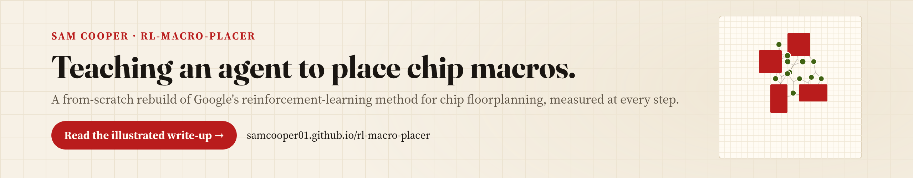
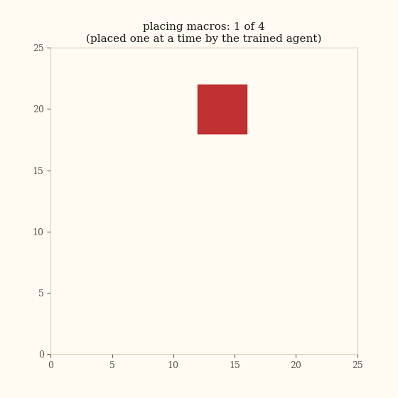

# rl-macro-placer

**A from-scratch rebuild of Google's reinforcement-learning method for placing chip macros, built in six versions that each add one piece of the paper and are measured against random placement on the same problems.**

<a href="https://samcooper01.github.io/rl-macro-placer/"></a>

<p align="center">
  <a href="https://samcooper01.github.io/rl-macro-placer/"><b>Illustrated write-up</b></a> ·
  <a href="HOW_IT_WORKS.md">How it works</a> ·
  <a href="RESULTS.md">Results in plain text</a> ·
  <a href="https://www.linkedin.com/in/sam-cooper12/">Sam Cooper on LinkedIn</a>
</p>

In 2021, Google researchers reported that a reinforcement-learning agent could produce chip
floorplans as good as or better than human experts' in under six hours (Mirhoseini, Goldie, et
al., "A graph placement methodology for fast chip design," Nature 2021,
[arXiv 2004.10746](https://arxiv.org/abs/2004.10746), with open-source code in
[Circuit Training](https://github.com/google-research/circuit_training)).

This project rebuilds that method at laptop scale. The goal was to understand each piece of the
method by building it, and to find out which pieces actually help at this scale.

<p align="center">
  
  <br>
  <sub>The trained V2 agent places four macros (red) one at a time, then the standard-cell clusters (green) settle around them.</sub>
</p>

## How it works

The agent places the large fixed blocks (macros) on a grid one at a time, never on a cell where
a macro would overlap another or hang off the edge. Once every macro is down, a force-directed
step places the clusters of standard cells around them, and the finished layout gets one score:
a weighted sum of wirelength, congestion and density. That single score is all the agent learns
from, through Maskable Proximal Policy Optimization (MaskablePPO).

| Version | Adds |
| --- | --- |
| [V1](V1/) | The learning loop, scored on wirelength alone |
| [V2](V2/) | The paper's three-part cost and force-directed cell placement |
| [V3](V3/) | A new random problem every episode, tested on 200 unseen problems |
| [V4](V4/) | The netlist as a graph, read by a Graph Neural Network (GNN) |
| [V5](V5/) | A spatial output layer built from convolutions |
| [V6](V6/) | A scaling study from 4 to 14 macros |

## Results

Lower cost is better. V1 is scored on wirelength alone.

| Version | Tested on | Learned cost | Random average | Better than random by |
| --- | --- | --- | --- | --- |
| V1 | One fixed problem | 12 (wirelength) | 133 (wirelength) | 91 percent |
| V2 | One fixed problem | 42.1 | 44.7 | 5.8 percent |
| V3 | 200 unseen problems | 44.1 | 45.2 | 2.6 percent |
| V4 | The same 200 | 44.1 | 45.2 | 2.4 percent |
| V5 | The same 200 | 44.3 | 45.2 | 2.1 percent |
| V6 | 40 unseen problems per size | Flat and graph policies | | −0.9 to +2.7 percent, within the noise |

- **The learning loop works.** On one fixed problem, V1's layout uses about a tenth of the wire
  of an average random one, and V2 beats 90 percent of random layouts.
- **Placing well on unseen problems is much harder.** Keeping the cheapest of 100 random
  layouts beats V3 on 191 of the 200 test problems.
- **The paper's architecture did not help at this scale.** The Graph Neural Network (GNN) (V4)
  and the spatial output layer (V5) score within a fraction of a point of V3. All three place
  the macros in nearly the same arrangement on every problem instead of adapting to each one.
- **A scaling trend did not hold up.** A first scaling study suggested the graph policy pulls
  ahead as problems grow. A second run did not show it, and the noise between runs is too large
  for either run to settle the question.

Each version was trained once, so small differences between versions could be run-to-run
variation. The full numbers are in [RESULTS.md](RESULTS.md).

## Repository

```
docs/            the illustrated write-up (served at samcooper01.github.io/rl-macro-placer)
V1/ ... V6/      one folder per version: environment, training, evaluation, figures
final/           the files the final run (V6) used, gathered in one place
hero/            an 8-macro demonstration setup
HOW_IT_WORKS.md  the mechanics, and where this matches and differs from the paper
RESULTS.md       the numbers in plain text
```

Later versions reuse earlier building blocks (`force_directed.py`, `metrics.py`,
`gnn_extractor.py`). The `results.html` page in each version folder is an early write-up from
when that version was built; where it disagrees with the illustrated write-up, the write-up is
current.

## Running it

```bash
python3 -m venv venv && source venv/bin/activate
pip install -r requirements.txt

cd V2 && python3 visualize.py     # trains and saves before-and-after placement images
cd V6 && python3 run_scaling.py   # runs the scaling study
```

The cell placement and scoring run on the processor. From V4 on, the policy network runs on a
graphics card if one is available.

Built with [PyTorch](https://pytorch.org/), [Gymnasium](https://gymnasium.farama.org/),
[Stable-Baselines3](https://stable-baselines3.readthedocs.io/),
[sb3-contrib](https://sb3-contrib.readthedocs.io/), [NumPy](https://numpy.org/) and
[Matplotlib](https://matplotlib.org/).

## References

1. Mirhoseini, Goldie, et al. "A graph placement methodology for fast chip design." *Nature* 594, 2021.
   [doi:10.1038/s41586-021-03544-w](https://doi.org/10.1038/s41586-021-03544-w),
   [arXiv 2004.10746](https://arxiv.org/abs/2004.10746). The method this project rebuilds.
2. Google Research. [Circuit Training](https://github.com/google-research/circuit_training).
   The paper's open-source code.
3. Cheng, Kahng, Kundu, Wang and Wang. "An Updated Assessment of Reinforcement Learning for
   Macro Placement." 2023. [arXiv 2302.11014](https://arxiv.org/abs/2302.11014). An independent
   evaluation of the paper's claims against classical placers.
4. Schulman, Wolski, Dhariwal, Radford and Klimov. "Proximal Policy Optimization Algorithms."
   2017. [arXiv 1707.06347](https://arxiv.org/abs/1707.06347). The training method.
5. Schulman, Moritz, Levine, Jordan and Abbeel. "High-Dimensional Continuous Control Using
   Generalized Advantage Estimation." 2015. [arXiv 1506.02438](https://arxiv.org/abs/1506.02438).
   The advantage estimate used in training.
6. Huang and Ontañón. "A Closer Look at Invalid Action Masking in Policy Gradient Algorithms."
   2020. [arXiv 2006.14171](https://arxiv.org/abs/2006.14171). Why masking illegal moves works.
7. Kipf and Welling. "Semi-Supervised Classification with Graph Convolutional Networks." 2016.
   [arXiv 1609.02907](https://arxiv.org/abs/1609.02907). The graph network design used in V4
   and V5.
8. Raffin, Hill, Gleave, Kanervisto, Ernestus and Dormann. "Stable-Baselines3: Reliable
   Reinforcement Learning Implementations." *Journal of Machine Learning Research* 22(268),
   2021. [jmlr.org/papers/v22/20-1364](https://jmlr.org/papers/v22/20-1364.html). The training
   library.
